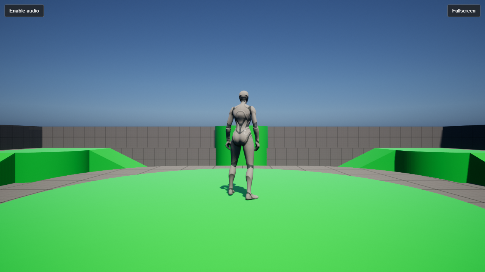

# UnrealEngine-WebGPU 5.7 for Windows

**Build Unreal Engine 5.7.4 games for the browser with WebGPU and WebAssembly, from a Windows PC.**

[](LICENSE)



This is a port of Pooya Eimandar's
[UnrealEngine-WebGPU](https://github.com/PooyaEimandar/UnrealEngine-WebGPU) to
**Unreal Engine 5.7.4**, built and tested on **Windows**. The original adds an
HTML5 target platform and a WebGPU renderer to Unreal Engine 5.8.3 and is built
on macOS. This port is for projects that must stay on 5.7, for example because
their cooked content comes from a 5.7 build, and for developers working on
Windows.

The game runs on the visitor's GPU, in the browser tab. No streaming server and
no server-side GPU are needed: the host only serves static files.

This public repository contains documentation only. The engine source is in a
restricted fork of Epic's repository:
[samysheesh/UnrealEngine, branch `5.7-webgpu`](https://github.com/samysheesh/UnrealEngine/tree/5.7-webgpu).
Like Epic's own repository, it opens only for GitHub accounts linked to an Epic
Games account (see [Get access](#1-get-access-to-the-source)). This is a
modified engine, not a plugin for the Epic Games Launcher build.

## What this port changes

The fork is Epic's 5.7.4 release with the `5.8-webgpu` branch of
UnrealEngine-WebGPU grafted on top: the HTML5 platform, the WebGPU RHI, Dawn and
the WebGPU shader format. On top of that graft:

| Area | Change |
|---|---|
| Unreal 5.7 API | A compatibility layer for the RHI interfaces that changed between 5.7 and 5.8 (`WebGPURHICompat.h`, `WEBGPU_RHI_57`), plus the 5.7 versions of the shader compiler, UBT and UAT entry points. |
| Windows build | Emscripten's `.exe` launchers are found on Windows; the third-party scripts run under Git Bash with native paths; FreeType 2.10.0 and the Opus build recipes of 5.7; the prebuilt Dawn library links with MSVC 14.44. |
| Runtime platform | The HTML5 platform layer adapted to the 5.7 core (platform properties, file paths, crypto settings for encrypted paks). |
| Frame rate | Bind group cache keyed by hash, redundant bind group and vertex/index buffer bindings skipped, multi-frame uniform buffers written in place, batched ring-buffer uploads, render-pass merging for the game canvas, frame pacing that does not wait for an extra animation frame. On our test project in Chrome (RTX 3080, Shipping): from about 26 to about 55 frames per second. |
| Input | Pointer lock is requested only when the game hides the cursor (a visible cursor with `LockOnCapture` stayed usable); gamepads are polled only when one is connected. |
| Content delivery | Downloaded pak/IoStore blocks persist in the browser's Cache Storage, under a version written by UAT: a second visit reads them back without downloading them (157 MB read back, no request, on our test project). |
| Diagnostics | Without a WebGPU adapter (for example with hardware acceleration turned off), the engine says so, including in Shipping, instead of exiting with code 1. |

## Status

| Build host | Status |
|---|---|
| Windows 11 x64 | Verified: editor, ShaderCompileWorker, UnrealPak, third-party libraries for WebAssembly, `UnrealGame HTML5`, a C++ game target, cooking and packaging from the command line |
| macOS, Linux | Not tested with this port. For macOS, the original 5.8 project is the reference. |

Browsers verified: Google Chrome 155-156 and Brave (Chromium 155) on Windows,
with hardware acceleration on. The renderer is Unreal's mobile renderer; the
feature list and browser restrictions of the
[original documentation](https://github.com/PooyaEimandar/UnrealEngine-WebGPU#feature-support-and-roadmap)
apply.

Not done on Windows:

- The bundled native host (Sib, in Rust) is not built. Packages are served with
  [`tools/serve.py`](tools/serve.py) or any web server configured as described
  in [Hosting](#hosting).
- Packaging was run from the command line (`RunUAT BuildCookRun`). The editor's
  **Platforms → Package Project** menu was not tested.
- Development builds are linked without DWARF debug information (see step 3).

## Before you build

| Requirement | What we used |
|---|---|
| Source access | A GitHub account linked to Epic Games |
| Windows | Windows 11 x64 |
| Visual Studio | Visual Studio 2022 Build Tools, MSVC 14.44, with the **C++ CMake tools** component (it provides CMake and Ninja) |
| Windows SDK | 10.0.22621 |
| Git | Git for Windows (its `bash.exe` runs the fork's third-party build script) |
| Emscripten | **6.0.10** through emsdk, with the Node.js and Python that emsdk installs |
| Memory | 32 GB or more; build with about 10 parallel actions |
| Browser | Chrome, Edge or Brave with WebGPU, WebAssembly JSPI and hardware acceleration |

Rust is not needed (see Status).

## 1. Get access to the source

1. Follow [Epic's GitHub access guide](https://www.unrealengine.com/ue-on-github)
   to link your Epic Games and GitHub accounts, and accept the invitation to the
   EpicGames organization.
2. Check that [EpicGames/UnrealEngine](https://github.com/EpicGames/UnrealEngine)
   opens while you are signed in.
3. Check that
   [samysheesh/UnrealEngine, branch `5.7-webgpu`](https://github.com/samysheesh/UnrealEngine/tree/5.7-webgpu)
   opens.

A **404** means that your account does not have access yet. If Epic's repository
opens but the fork does not, open an issue in this repository. Access remains
subject to Epic's terms; this repository does not grant an Unreal Engine license.

## 2. Install the tools

Install Emscripten 6.0.10 with emsdk, for example in `E:\emsdk`:

```bat
git clone https://github.com/emscripten-core/emsdk.git E:\emsdk
cd /d E:\emsdk
emsdk install 6.0.10
emsdk activate 6.0.10
```

Every build command below runs in a `cmd` window prepared like this. Adjust the
paths to your installation; nothing is written to the system environment:

```bat
set EMSDK=E:\emsdk
set EM_CONFIG=E:\emsdk\.emscripten
set EMSDK_PYTHON=E:\emsdk\python\3.13.3_64bit\python.exe
set VSCMAKE=C:\Program Files (x86)\Microsoft Visual Studio\2022\BuildTools\Common7\IDE\CommonExtensions\Microsoft\CMake
set PATH=%EMSDK%;%EMSDK%\upstream\emscripten;%EMSDK%\node\24.19.0_64bit;%EMSDK%\python\3.13.3_64bit;%VSCMAKE%\CMake\bin;%VSCMAKE%\Ninja;%PATH%
set CMAKE_GENERATOR=Ninja
```

`EMSDK_PYTHON` keeps Emscripten away from the Microsoft Store `python3` alias.

## 3. Clone and build the engine

```bat
git clone --branch 5.7-webgpu --single-branch https://github.com/samysheesh/UnrealEngine.git E:\UE57web
cd /d E:\UE57web
Setup.bat
GenerateProjectFiles.bat
```

If you exclude platforms from `Setup.bat` to save space, keep the files under
`Engine/Source/Programs/AutomationTool/IOS/`: UAT compiles that project.

Then, in order, each step finishing before the next:

```bat
rem The editor (it includes the HTML5 target modules)
call Engine\Build\BatchFiles\Build.bat UnrealEditor Win64 Development -WaitMutex -MaxParallelActions=10

rem The tools used by cooking and packaging
call Engine\Build\BatchFiles\Build.bat -Target="ShaderCompileWorker Win64 Development" -Target="UnrealPak Win64 Development" -WaitMutex -MaxParallelActions=10

rem The third-party libraries for WebAssembly (ICU, libpng, FreeType, HarfBuzz, Ogg, Vorbis, Opus, BLAKE3, ...)
"C:\Program Files\Git\bin\bash.exe" Engine/Platforms/HTML5/Build/BuildThirdParty.sh --jobs 10

rem The shared browser executable for Blueprint-only projects
call Engine\Build\BatchFiles\Build.bat UnrealGame HTML5 Development -WaitMutex -MaxParallelActions=10 -NoDebugInfo
```

Two Windows-specific limits:

- **Parallelism.** With 22 parallel actions, MSVC failed with `C3859` (it could
  not reserve memory for precompiled headers); 10 worked.
- **`-NoDebugInfo`.** With full DWARF debug information, the link-time
  `wasm-opt` pass of a large game needed more than 40 GB of memory. Without
  DWARF, add `--profiling-funcs` to the project's additional linker flags to
  keep function names in browser stack traces.

## 4. Package the Third Person template

The fork's script creates a project from an engine template:

```bat
"%EMSDK_PYTHON%" Engine\Platforms\HTML5\Build\Scripts\MakeTemplateProject.py TP_ThirdPersonBP E:\HTML5Template
```

Add this to the project's `Config/DefaultEngine.ini` before cooking:

```ini
[/Script/Engine.RendererSettings]
r.Mobile.SupportGPUScene=0
```

The editor that cooks reads this setting too. If it stays at 1 there while the
browser runs with 0, the cooked shaders expect a buffer that the browser never
binds, and WebGPU rejects the draw calls.

Then cook, stage and package:

```bat
call Engine\Build\BatchFiles\RunUAT.bat BuildCookRun -project="E:\HTML5Template\HTML5Template.uproject" -platform=HTML5 -clientconfig=Development -cook -stage -pak -archive -archivedirectory="E:\HTML5Package" -unattended -utf8output
```

A C++ project builds its own game target first
(`Build.bat <Game> HTML5 Development -NoDebugInfo`), then runs `BuildCookRun`
with `-skipbuild`. Add `-iostore` for IoStore containers.

## 5. Run it in a browser

```bat
python tools\serve.py E:\HTML5Package\HTML5 8000
```

Open the `.html` page that UAT staged under `Binaries/HTML5/`, at the same path
relative to the package folder. For a C++ project it is
`http://127.0.0.1:8000/<Project>/Binaries/HTML5/<Project>-HTML5-<Configuration>.html`.

If the page log shows "WebGPU unavailable", turn on hardware acceleration in the
browser settings ("Use graphics acceleration when available"), restart the
browser and reload.

## Hosting

The packaged folder is static. Any web server works if it:

- serves over **HTTPS** (or `localhost`);
- sends `Cross-Origin-Opener-Policy: same-origin` and
  `Cross-Origin-Embedder-Policy: require-corp` on the page and its files;
- answers **byte-range** requests with `206 Partial Content` for the files listed
  in `HTML5Content.txt`, **without** `Content-Encoding` (the containers are
  already compressed);
- compresses the `.wasm` and `.js` files. In our Shipping build, the WebAssembly
  went from 138 MB to 21 MB with brotli once its name section was removed.

Deploy each release to a new directory: a client that is running must not see
containers change under it. The fork's `Engine/Platforms/HTML5/docs/HOSTING.md`
and `M10-STREAMING.md` give the details, including the persistent block cache.

## License

The documentation in this repository is licensed under
[Creative Commons Attribution 4.0 International](LICENSE). Its structure and parts
of its text are adapted from the
[UnrealEngine-WebGPU documentation](https://github.com/PooyaEimandar/UnrealEngine-WebGPU)
© 2026 Pooya Eimandar, CC BY 4.0; changed for Unreal Engine 5.7.4 and Windows.
`tools/serve.py` is under the MIT license.

This license does **not** apply to Unreal Engine source code, engine
modifications, Epic-provided assets or third-party components. Unreal Engine and
its modifications remain subject to the
[Unreal Engine EULA](https://www.unrealengine.com/eula/unreal); third-party
components keep their own licenses.

Unreal Engine is a trademark or registered trademark of Epic Games, Inc. This is
an independent community project, not an official Epic Games product, and not
endorsed by Epic Games or by the author of the original project.
